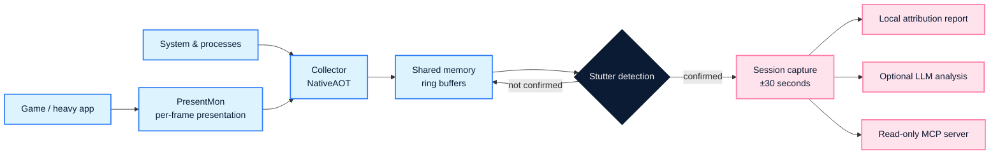

<div align="center">
  <a href="https://github.com/worldcopyist/AzureGameAssiant">
    
  </a>

  <h1>AzureGameAssistant</h1>

  <p><strong>When a stutter hits, get evidence: which frames were slow, who was taking the resources, and what most likely caused it.</strong></p>

  <p>Local-first · Very low overhead · No game injection · Windows 10 / 11</p>

  <p>
    <a href="https://github.com/worldcopyist/AzureGameAssiant/releases/latest"><strong>Download v0.1.0</strong></a>
    ·
    <a href="https://game-stutter-lab-bgfqcqcjijr.qoder.zone">Showcase site</a>
    ·
    <a href="#quick-start">Get started in 5 steps</a>
    ·
    <a href="README.md">简体中文</a>
  </p>

  <p>
    
    
    
    
  </p>
</div>

> **In one sentence**: you barely notice it while playing; within minutes of a stutter it gives you a local attribution report backed by timeline evidence, and keeps the recording so you can compare before and after tweaking settings.

[简体中文](README.md) · **English** · [GitHub repository](https://github.com/worldcopyist/AzureGameAssiant) · [Releases](https://github.com/worldcopyist/AzureGameAssiant/releases) · [Third-party notices](THIRD-PARTY-NOTICES.md) · [GPL-3.0](LICENSE)

---

## Contents

| What you need | Where to go |
| --- | --- |
| What it is and what it answers | [Overview](#overview) · [Questions it answers](#questions-it-answers) |
| How to download and start | [Quick start](#quick-start) |
| Capabilities and footprint | [Features](#features) · [Performance](#performance) |
| Where the data comes from | [How it works](#how-it-works) |
| CPU temperature, PawnIO, AI, MCP | [Advanced usage](#advanced-usage) |
| Build, test and contribute | [Development](#development) |
| License and referenced projects | [Open source and license](#open-source-and-license) |

---


## Overview

Many frame drops are not “the PC is too slow”. They are observable resource events at a specific moment: a background app grabbing CPU, VRAM exhaustion, paging under memory pressure, or a disk/driver-induced scheduling stall.

Task Manager shows “now”, not “that one second”. Averages alone cannot explain why a single frame took longer. A 60 FPS average can still contain 200 ms frames — that is what players feel, and an average will never reveal it.

AzureGameAssistant continuously samples system, process and per-frame presentation data at very low cost, keeps it in in-memory ring buffers, and when a stutter is detected, freezes the 30 seconds before and after into a session. You can replay the timeline and get process-level and frame-level attribution.

It does not inject into games, does not read window titles, does not upload frame data, and makes no network requests by default. The desktop app only samples, analyzes locally, and optionally explains results with a user-triggered LLM.

### Questions it answers

| Situation | What you get |
| --- | --- |
| A sudden drop in a team fight | Which frames got long, and whether the game was waiting on GPU, CPU or the display path |
| A background app stealing resources | The processes using the most CPU / GPU / VRAM / memory / disk around the stutter |
| Whether a tweak actually helped | Frame time, 1% Low, stutter count and primary cause across two sessions of the same game |
| A rare stutter you cannot reproduce | Press the global hotkey to mark it; the surrounding 30 seconds are preserved |
| Whether thermals or power are limiting | CPU / GPU temperature, hotspot and power clues (optional sensors) |

---


## Quick start

The portable package is published on [GitHub Releases](https://github.com/worldcopyist/AzureGameAssiant/releases/latest). Unzip and run; no separate .NET installation is required.

| Step | Do this | What you see |
| --- | --- | --- |
| **01 Launch** | Unzip `AzureGameAssistant-0.1.0-win-x64.zip` and run `AzureGameAssistant.exe` | A blue cat avatar appears in the tray; system metrics start updating |
| **02 Confirm capture** | Check the collector status at the bottom; frame capture needs administrator rights | Status reads “connected”; complete the one-time UAC prompt when asked |
| **03 Play** | Launch your game normally; the foreground game is detected automatically | Sampling switches from 1 s to 200 ms; FPS and frame time are recorded |
| **04 Review the stutter** | Press the hotkey when it stutters, or wait for automatic detection | An event appears on the timeline; open Session Replay to inspect ±30 s |
| **05 Tune and compare** | Read the local attribution report, adjust, then play again | Compare frame time and primary cause between the old and new sessions |

> **No API key required**: frame capture, stutter detection, session replay, local attribution and report export all work offline. AI analysis is only an optional deep-dive.

**Requirements**: Windows 10 1909+ / Windows 11, x64. Deep frame capture requires administrator rights. For anti-cheat-sensitive games, start with `--safe-mode` to keep only injection-free system sampling.

---


## Features

| Area | Capability |
| --- | --- |
| **System sampling** | CPU, memory, commit, page file, GPU usage, VRAM, disk and system queue; 1 s normally, 200 ms in-game |
| **Frame-level truth** | Intel PresentMon for frametime, CPU/GPU wait, display latency, 1% Low and 0.1% Low; no custom ETW, no injection |
| **Low-overhead retention** | 15-minute system ring buffer + 3-minute frame ring buffer; nothing is written to disk until a stutter is confirmed |
| **Stutter detection** | Frame spikes first, combined with timer jitter, resource spikes and memory/VRAM/disk pressure; global hotkey for manual marks |
| **Attribution report** | CPU / GPU / VRAM / memory / disk / frame pacing / shader compilation / asset streaming / thermal throttling, in Chinese and English |
| **Vendor sensors** | Optional sidecar built on LibreHardwareMonitor (NVML / ADL / IGCL) for temperature, hotspot, power, clocks, fans and VRAM; no kernel driver loaded |
| **Timeline replay** | Metrics and frame track share one timeline; pause, zoom, pan and hover to inspect the same instant |
| **Optional AI** | OpenAI-compatible APIs and local models (Ollama / LM Studio) over a redacted fact layer; off by default, manual trigger, budget-capped |
| **Agent access** | Read-only stdio MCP server for Qoder, Claude Desktop and other agents; hardware snapshot, history, frame stats and diagnostics |
| **High-load mode** | When another process is very busy, sheds load automatically: sampling, FPS and stutter marks stay, charts/overlay/sessions/notifications pause |
| **Privacy boundary** | No telemetry, no crash upload, no auto-update; no network request unless you explicitly enable AI |

---


## Performance

| Item | Target | Measured (Release) |
| --- | --- | --- |
| UI process (tray baseline, 30 min) | ≤ 60 MB | **50.94 MB** |
| Collector (NativeAOT, shallow mode) | ≤ 30 MB | **11.30 MB** |
| Collector average CPU | ≤ 0.3% | **0.086%** |
| Idle disk writes | Logs only, ≤ 10 KB/min | Log rotation only |
| Time to inspect a stutter | ≤ 2 s | Replay is available as soon as the event is confirmed |

Quality baseline: **325 automated tests** pass, **22 UI automation smoke checks** pass, and the Release build has **0 warnings, 0 errors**. Resource budgets are asserted by tests and scripts; see [docs](docs/development.md) for details.

---


## How it works



- **Collector and UI are separate processes**: the collector is windowless, NativeAOT-compiled, publishes samples through shared memory and accepts control commands through a named pipe.
- **Ring buffers**: 15 minutes of system data and 3 minutes of frame data; only ±30 seconds around a confirmed event is written to a session.
- **Atomic sessions**: a readable `recording` file is written first, then atomically rewritten to `complete`; a crash never leaves a half-written session.
- **Evidence before AI**: local rules produce the primary cause and evidence first; AI is only an optional explanation layer, and a full local report remains when AI fails.

---


## Advanced usage

### CPU temperature and PawnIO

By default, CPU temperature comes from the ACPI thermal zone and needs no driver. If your board or system does not expose a usable ACPI zone, switch the CPU temperature source to “driver” in Settings; LibreHardwareMonitor then reads it through **PawnIO**.

PawnIO is a separate kernel driver. It is **not bundled** with this project and must be downloaded and installed by you:

| Entry | Address |
| --- | --- |
| Official website | [https://pawnio.eu/](https://pawnio.eu/) |
| Direct download (latest installer) | [PawnIO_setup.exe](https://github.com/namazso/PawnIO.Setup/releases/latest/download/PawnIO_setup.exe) |
| Release page (2.2.0) | [github.com/namazso/PawnIO.Setup/releases/tag/2.2.0](https://github.com/namazso/PawnIO.Setup/releases/tag/2.2.0) |

After installation, choose “driver” in Settings; the collector restarts and tries to read CPU temperature. The driver is demand-start (`DEMAND_START`) and is not loaded at boot. To uninstall:

```powershell
PawnIO_setup.exe -uninstall -silent
```

> **Anti-cheat notice**: some game anti-cheat systems may treat kernel drivers as an abnormal environment. This app never installs, updates or silently loads PawnIO. The choice and timing are yours. Before playing an anti-cheat-sensitive game, you can run `sc stop PawnIO` or switch back to ACPI mode.

### AI analysis (optional)

- OpenAI-compatible endpoints plus local models such as Ollama / LM Studio.
- API keys live only in Windows Credential Manager; they are never written to settings, logs or reports.
- Manual by default: review the redacted JSON, estimated tokens and cost before anything is sent.
- Optional “auto-analyze severe events” (off by default): one request only after a complete session is saved, the score threshold is met, the budget allows it and the current configuration was approved.
- On failure, timeout or budget exhaustion, the local attribution report is used instead.

### Read-only MCP server

```powershell
powershell -File build/publish-mcp.ps1
```

The output is `artifacts/mcp/AzureGameAssistant.Mcp.exe`. Register it with your agent:

```json
{
  "mcpServers": {
    "azure-game-assistant": {
      "command": "C:\\path\\to\\AzureGameAssistant.Mcp.exe"
    }
  }
}
```

Tools: `get_hardware_snapshot`, `get_history`, `get_frame_stats`, `list_processes`, `diagnose`, `get_collector_status`. All are read-only with bounded arguments and never modify the system.

### Safe mode

```powershell
AzureGameAssistant.exe --safe-mode
```

Safe mode does not elevate, does not load PresentMon / ETW frame capture and does not start the sensor sidecar. Only PDH / NT API system and process sampling remains, and the UI shows “shallow mode (no frame timeline)”.

### Privacy and diagnostics

All captured data stays in `%LOCALAPPDATA%\AzureGameAssistant\` by default. “Export redacted diagnostics” produces a ZIP with the latest long-run record, hardware snapshot and a whitelisted settings summary. Usernames, absolute paths, UNC paths, Bearer / `sk-*` keys, emails and IPv4 addresses are removed before export.

---


## Development

```powershell
dotnet build AzureGameAssistant.sln
dotnet test AzureGameAssistant.sln

powershell -File build/run-dev.ps1                  # build and launch the UI
powershell -File build/run-dev.ps1 -Tray            # start hidden in the tray
powershell -File build/measure.ps1 -DurationMinutes 1
powershell -File build/ui-smoke.ps1                 # non-elevated UI automation smoke
powershell -File build/package.ps1                  # NativeAOT portable package
powershell -File build/publish-mcp.ps1              # read-only MCP server
```

Packaging the NativeAOT collector requires the “Desktop development with C++” workload in Visual Studio Build Tools; `package.ps1` fails with a clear message when it is missing.

### Tech stack

| Layer | Implementation |
| --- | --- |
| Collector | C# / .NET 8 + NativeAOT, PDH performance counters + NT process APIs |
| Frame data | Bundled Intel PresentMon console app, child process + streaming CSV parsing |
| Sensor sidecar | LibreHardwareMonitorLib, GPU hardware group only; optional CPU driver mode |
| UI | C# / .NET 8 + WPF, MVVM, custom-drawn timeline, no heavy chart library |
| IPC | Shared memory (system / frames / sensors) + named pipe (control) |
| Storage | gzip-compressed JSONL sessions, atomic writes, monthly software issue logs |
| AI | OpenAI-compatible API, BYOK, Windows Credential Manager |
| Agent | MCP stdio JSON-RPC 2.0, separate read-only process |

### Project layout

```text
AzureGameAssistant.sln
├─ src/
│  ├─ AzureGameAssistant.Core/       shared models, IPC, detection, sessions, charts, attribution
│  ├─ AzureGameAssistant.Collector/  NativeAOT collector
│  ├─ AzureGameAssistant.Sensors/    LibreHardwareMonitor sensor sidecar
│  ├─ AzureGameAssistant.UI/         WPF UI, tray, overlay, charts
│  ├─ AzureGameAssistant.Ai/         AI endpoints, budget, redaction, reports, cache
│  ├─ AzureGameAssistant.Mcp/        read-only MCP stdio server
│  └─ AzureGameAssistant.Tests/      xUnit tests
├─ build/                            build, package, measure, smoke and video scripts
├─ docs/                             requirements / development / research / handoff / commit rules
├─ site/                             online showcase site
├─ third_party/                      PresentMon and third-party licenses
└─ THIRD-PARTY-NOTICES.md            component versions, licenses and compatibility
```

### Milestones

| Stage | Target | Status | Scope |
| --- | --- | --- | --- |
| M1 Foundation | v0.1 | **Done** | system sampling, process ranking, timeline, tray, settings, logging |
| M2 Frame truth | v0.5 | **Done, shipped in the preview** | PresentMon, stutter detection, session capture, replay, local attribution, hotkey, bilingual themes |
| M3 Depth | v1.0 | **Core features done** | sensors, AI, MCP, overlay, export, performance acceptance, portable ZIP; compatibility matrix and code signing remain |

### Documentation

| Document | Contents |
| --- | --- |
| [Requirements](docs/requirements.md) | goals, functional and non-functional requirements, acceptance criteria, risks |
| [Development](docs/development.md) | architecture, IPC, sampling, frame pipeline, sensors, AI, data model, algorithms, UI, build, tests |
| [Research](docs/research.md) | competitor matrix, reuse boundaries, license obligations, explicitly unused projects |
| [Handoff](docs/handoff.md) | current status, next steps, decisions, known issues |
| [Commit rules](docs/commit-guidelines.md) | commit / branch / issue / PR / release conventions |

---


## Open source and license

This project is released under the [GNU General Public License v3.0](LICENSE), Copyright (C) 2026 worldcopyist.

You may use, modify and redistribute it freely. If you distribute a modified version, it must also be open-sourced under GPL-3.0 with complete source code. License compatibility for third-party components and referenced projects is documented in [THIRD-PARTY-NOTICES.md](THIRD-PARTY-NOTICES.md), section 4.

### Used and referenced open-source projects

| Project | License | Relationship |
| --- | --- | --- |
| [Intel PresentMon](https://github.com/GameTechDev/PresentMon) | MIT | Bundled official console app; provides per-frame presentation data |
| [LibreHardwareMonitor](https://github.com/LibreHardwareMonitor/LibreHardwareMonitor) | MPL-2.0 | Uses `LibreHardwareMonitorLib` unmodified for vendor GPU sensors |
| [CapFrameX](https://github.com/CXWorld/CapFrameX) | MIT | Design reference for PresentMon child-process hosting, frame ring buffers and session metadata; no code copied |
| [StutterScope](https://github.com/AdenXie/StutterScope) | MIT | Design reference for offline report structure; no code copied |
| [game-stutter-recorder](https://github.com/jieke7k7k/game-stutter-recorder) | MIT | Design reference for game detection and conclusion writing; no code copied |
| [stutter-test](https://github.com/jkoens3/stutter-test) | No license | Concept-only reference for stutter categories, clean-room implementation; no code copied |
| [System Informer](https://github.com/winsiderss/systeminformer) | MIT | Interaction reference for process information; no code copied |
| [SidebarDiagnostics](https://github.com/ArcadeRenegade/SidebarDiagnostics) | GPL-3.0 | Layout reference for a desktop monitoring sidebar; no code copied; same license as this project |
| [PawnIO](https://pawnio.eu/) | GPL-2.0 | Optional kernel driver, not bundled, installed by the user; a separate program |

Component versions, hashes, full license locations and GPL-3.0 compatibility are in [THIRD-PARTY-NOTICES.md](THIRD-PARTY-NOTICES.md).

---

<div align="center">
  <sub>AzureGameAssistant · local-first game stutter diagnostics · GPL-3.0</sub>
</div>
