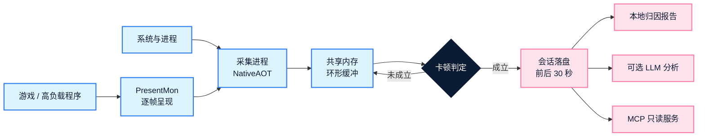

<div align="center">
  <a href="https://github.com/worldcopyist/AzureGameAssiant">
    
  </a>

  <h1>蓝天游戏助手 · AzureGameAssistant</h1>

  <p><strong>卡顿发生时，用证据回答：卡在哪一帧、当时谁在抢资源、最可能的原因是什么。</strong></p>

  <p>本地优先 · 极低开销 · 不注入游戏 · Windows 10 / 11</p>

  <p>
    <a href="https://github.com/worldcopyist/AzureGameAssiant/releases/latest"><strong>下载 v0.1.0</strong></a>
    ·
    <a href="https://game-stutter-lab-bgfqcqcjijr.qoder.zone">在线展示站</a>
    ·
    <a href="#快速开始">5 步上手</a>
    ·
    <a href="README.en.md">English</a>
  </p>

  <p>
    
    
    
    
  </p>
</div>

> **一句话**：平时几乎感觉不到它；卡顿发生后几分钟内，给你一份带时间轴证据的本地归因报告，并把这次记录留下来，方便调参前后对比。

**简体中文** · [English](README.en.md) · [GitHub 仓库](https://github.com/worldcopyist/AzureGameAssiant) · [Releases](https://github.com/worldcopyist/AzureGameAssiant/releases) · [第三方与开源声明](THIRD-PARTY-NOTICES.md) · [GPL-3.0](LICENSE)

---

## 目录

| 想了解 | 从这里开始 |
| --- | --- |
| 这是什么，能回答什么问题 | [概览](#概览) · [它能回答什么](#它能回答什么) |
| 怎么下载、怎么开始用 | [快速开始](#快速开始) |
| 有哪些能力，占多少资源 | [核心能力](#核心能力) · [性能数据](#性能数据) |
| 数据从哪来，卡顿怎么判定 | [工作原理](#工作原理) |
| CPU 温度、PawnIO、AI、MCP | [进阶使用](#进阶使用) |
| 自己构建、测试与参与 | [开发与构建](#开发与构建) |
| 许可证与参考项目 | [开源与许可](#开源与许可) |

---


## 概览

很多掉帧和卡顿并不是“电脑不行”，而是某一刻发生了可观测的资源事件：后台程序突然抢 CPU、显存吃满、内存耗尽触发换页、磁盘或驱动造成调度停顿。

任务管理器只能看到“现在”，看不到“刚才那一秒”；而只看平均值也解释不了“为什么这一帧慢了”。60 FPS 的平均帧里可能夹着 200 ms 的长帧，体感就是卡，但平均帧永远找不到问题。

蓝天游戏助手在后台以极低开销持续采样系统、进程与逐帧呈现数据，放进内存环形缓冲；一旦判定卡顿，就把卡顿前后各 30 秒固化成会话，在时间轴上还原现场，给出进程级与帧级归因。

它不注入游戏、不读窗口标题、不上传帧数据，默认不联网。桌面版只做采样、本地分析与可选的人工触发 AI 解读。

### 它能回答什么

| 场景 | 它会告诉你 |
| --- | --- |
| 团战瞬间掉帧 | 是哪几帧变长，以及当时在等 GPU、等 CPU，还是显示链路在排队 |
| 后台程序偷资源 | 卡顿前后 CPU / GPU / 显存 / 内存 / 磁盘占用最高的进程 |
| 调参到底有没有用 | 同一游戏两次会话的帧时间、1% Low、卡顿次数与主因变化 |
| 偶发卡顿说不清 | 按全局热键手动标记，自动保留前后各 30 秒证据 |
| 温度或功耗是否拖后腿 | CPU / GPU 温度、热点、功耗与降频线索（传感器可选） |

---


## 快速开始

便携包发布在 [GitHub Releases](https://github.com/worldcopyist/AzureGameAssiant/releases/latest)，解压即用，无需另装 .NET。

| 步骤 | 做什么 | 你会看到 |
| --- | --- | --- |
| **01 启动** | 解压 `AzureGameAssistant-0.1.0-win-x64.zip`，运行 `AzureGameAssistant.exe` | 托盘出现蓝色猫头像，主界面开始显示系统指标 |
| **02 确认采集** | 查看底部采集进程状态；帧采集需要管理员权限 | 显示「已连接」；需要时按提示完成一次 UAC 提权 |
| **03 进入游戏** | 正常游玩，前台游戏会被自动识别 | 采样从 1 秒切到 200 毫秒，帧率与帧时间开始记录 |
| **04 回看卡顿** | 卡顿时按热键手动标记，或等自动判定 | 时间轴出现事件；打开「会话回放」查看前后 30 秒 |
| **05 调整与对比** | 读本地归因报告，逐条调整后再玩一局 | 新会话与旧会话可直接对比帧时间与主因 |

> **不用 API Key 也能用**：帧采集、卡顿判定、会话回放、本地归因报告与报告导出全部可用。AI 分析只是可选的深度解读。

**系统要求**：Windows 10 1909+ / Windows 11，x64。深度帧采集需要管理员权限。对反作弊敏感的游戏可用 `--safe-mode` 启动，只保留无注入的系统采样。

---


## 核心能力

| 模块 | 能力 |
| --- | --- |
| **系统采集** | CPU、内存、提交量、页面文件、GPU 占用、显存、磁盘、系统队列；常规 1 秒 / 次，游戏时 200 毫秒 / 次 |
| **帧级真相** | 复用 Intel PresentMon 读取 frametime、CPU / GPU 等待、显示延迟、1% Low 与 0.1% Low；不自研 ETW、不注入游戏 |
| **低开销留存** | 15 分钟系统环形缓冲 + 3 分钟帧环形缓冲；平时不写盘，卡顿才落盘，磁盘几乎无感 |
| **卡顿判定** | 帧尖峰优先，叠加定时器抖动、资源尖峰、显存 / 内存 / 磁盘压力；支持全局热键手动标记 |
| **归因报告** | CPU / GPU / 显存 / 内存 / 磁盘 / 帧节奏 / 着色器编译 / 资产流送 / 热降频，输出中英文报告 |
| **厂商传感器** | 可选边车复用 LibreHardwareMonitor（NVML / ADL / IGCL），读取温度、热点、功耗、频率、风扇、显存；不加载内核驱动 |
| **时间轴回放** | 多指标与帧轨共用时间轴；暂停、缩放、平移、悬停查看同一时刻的全部数值 |
| **可选 AI 分析** | OpenAI 兼容接口与本地模型（Ollama / LM Studio），基于脱敏事实层生成结构化报告；默认关闭、手动触发、有预算上限 |
| **Agent 接入** | 只读 stdio MCP 服务，Qoder、Claude Desktop 等可直接读取硬件快照、历史、帧统计与诊断 |
| **高占用模式** | 检测到其他进程高负载时自动降载：只保留采样、帧率与卡顿标注，暂停图表、悬浮窗、会话与通知 |
| **隐私边界** | 无遥测、无崩溃上报、无自动更新；默认不发起任何网络请求 |

---


## 性能数据

| 项目 | 目标 | Release 实测 |
| --- | --- | --- |
| 界面进程（托盘基线，30 分钟） | ≤ 60 MB | **50.94 MB** |
| 采集进程（NativeAOT 浅模式） | ≤ 30 MB | **11.30 MB** |
| 采集进程平均 CPU | ≤ 0.3% | **0.086%** |
| 空闲磁盘写入 | 仅日志，≤ 10 KB / 分钟 | 仅日志轮换 |
| 卡顿事件可查看延迟 | ≤ 2 秒 | 事件确认后立即可回放 |

构建与质量基线：**325 项自动化测试**通过，**22 项 UI 自动化冒烟检查**通过，Release 构建 **0 警告 0 错误**。资源预算由测试与脚本断言，测量方法见 [开发文档](docs/development.md) 与 [交接文档](docs/handoff.md)。

---


## 工作原理



- **采集与界面分离**：采集进程无窗口、NativeAOT 编译，通过共享内存发布数据，通过命名管道接收控制命令。
- **环形缓冲**：系统数据保留 15 分钟、帧数据保留 3 分钟；只有判定成立时才把前后各 30 秒写入会话文件。
- **会话原子落盘**：先写可读的 `recording` 文件，结束后原位原子改写为 `complete`；异常退出也不会留下半截文件。
- **归因优先用证据**：先由本地规则给出主因与证据，再决定是否需要 AI 解释；AI 缺失或失败时仍能看到完整本地报告。

---


## 进阶使用

### CPU 温度与 PawnIO

默认使用 ACPI 热区读取 CPU 温度，不需要安装任何驱动。如果主板或系统不提供可用的 ACPI 热区，可以在设置中把 CPU 温度来源切到「驱动」模式，由 LibreHardwareMonitor 通过 **PawnIO** 读取。

PawnIO 是独立的内核驱动，**不随本项目分发**，需要你自行下载并安装：

| 入口 | 地址 |
| --- | --- |
| 官方网站 | [https://pawnio.eu/](https://pawnio.eu/) |
| 直接下载（最新安装包） | [PawnIO_setup.exe](https://github.com/namazso/PawnIO.Setup/releases/latest/download/PawnIO_setup.exe) |
| 版本页（2.2.0） | [github.com/namazso/PawnIO.Setup/releases/tag/2.2.0](https://github.com/namazso/PawnIO.Setup/releases/tag/2.2.0) |

安装后在设置页选择「驱动」，采集进程会重启并尝试读取 CPU 温度。驱动为按需启动（`DEMAND_START`），不会随系统自动加载；卸载命令：

```powershell
PawnIO_setup.exe -uninstall -silent
```

> **反作弊提示**：内核驱动可能被部分游戏反作弊视为环境异常。本程序不会自动安装、自动更新或静默加载 PawnIO；是否安装、何时安装由你决定。玩反作弊敏感游戏前可执行 `sc stop PawnIO`，或改用 ACPI 模式。

### AI 分析（可选）

- 支持 OpenAI 兼容接口，以及 Ollama / LM Studio 等本地模型。
- API Key 只保存在 Windows Credential Manager，不写入配置、日志或报告。
- 默认手动触发：发送前展示脱敏 JSON、预计 token 与费用，确认后才联网。
- 可开启「严重事件自动分析」（默认关闭）：仅在完整会话落盘、评分达标、预算未耗尽且已同意当前配置时请求一次。
- 请求失败、超时或预算不足时自动回退到本地归因报告。

### MCP 只读服务

```powershell
powershell -File build/publish-mcp.ps1
```

产物为 `artifacts/mcp/AzureGameAssistant.Mcp.exe`。在 Agent 的 MCP 配置中登记：

```json
{
  "mcpServers": {
    "azure-game-assistant": {
      "command": "C:\\path\\to\\AzureGameAssistant.Mcp.exe"
    }
  }
}
```

可用工具：`get_hardware_snapshot`、`get_history`、`get_frame_stats`、`list_processes`、`diagnose`、`get_collector_status`。全部只读、参数有界，不修改系统。

### 安全模式

```powershell
AzureGameAssistant.exe --safe-mode
```

安全模式不提权、不加载 PresentMon / ETW 帧采集、不启动传感器边车，只保留 PDH / NT API 级别的系统与进程采样，界面顶部会显示「浅模式（无帧时间轴）」。

### 隐私与诊断

所有采集数据默认只保存在本机 `%LOCALAPPDATA%\AzureGameAssistant\`。设置中的「导出脱敏诊断包」会生成 ZIP，内含最近一次长跑记录、硬件快照与白名单设置摘要；导出前统一脱敏用户名、绝对路径、UNC 路径、Bearer / `sk-*` 密钥、邮箱与 IPv4 地址。

---


## 开发与构建

```powershell
dotnet build AzureGameAssistant.sln
dotnet test AzureGameAssistant.sln

powershell -File build/run-dev.ps1                  # 构建并启动界面
powershell -File build/run-dev.ps1 -Tray            # 直接隐藏到托盘启动
powershell -File build/measure.ps1 -DurationMinutes 1
powershell -File build/ui-smoke.ps1                 # 非提权 UI 自动化冒烟
powershell -File build/package.ps1                  # NativeAOT 便携包
powershell -File build/publish-mcp.ps1              # 只读 MCP 服务
```

NativeAOT 采集进程打包需要 Visual Studio Build Tools 的「使用 C++ 的桌面开发」工作负载；缺失时 `package.ps1` 会明确报错。

### 技术栈

| 层 | 实现 |
| --- | --- |
| 采集进程 | C# / .NET 8 + NativeAOT，PDH 性能计数器 + NT 进程信息 API |
| 帧数据 | 随包分发 Intel PresentMon 控制台程序，子进程 + CSV 流式解析 |
| 传感器边车 | LibreHardwareMonitorLib，仅 GPU 硬件组；可选 CPU 驱动模式 |
| 界面 | C# / .NET 8 + WPF，MVVM，自绘时间轴，不引入重型图表库 |
| 进程通信 | 共享内存（系统 / 帧 / 传感器遥测）+ 命名管道（控制命令） |
| 存储 | gzip 压缩 JSONL 会话，原子写入；按月归档软件问题日志 |
| AI | OpenAI 兼容接口，BYOK，Windows Credential Manager |
| Agent | MCP stdio JSON-RPC 2.0，独立只读进程 |

### 项目结构

```text
AzureGameAssistant.sln
├─ src/
│  ├─ AzureGameAssistant.Core/       共享模型、IPC、判定、会话、图表、归因
│  ├─ AzureGameAssistant.Collector/  NativeAOT 采集进程
│  ├─ AzureGameAssistant.Sensors/    LibreHardwareMonitor 传感器边车
│  ├─ AzureGameAssistant.UI/         WPF 界面、托盘、悬浮窗、图表
│  ├─ AzureGameAssistant.Ai/         AI 端点、预算、脱敏、报告与缓存
│  ├─ AzureGameAssistant.Mcp/        只读 MCP stdio 服务
│  └─ AzureGameAssistant.Tests/      xUnit 测试
├─ build/                            构建、打包、测量、冒烟与视频渲染脚本
├─ docs/                             需求 / 开发 / 调研 / 交接 / 提交规范
├─ site/                             在线展示站
├─ third_party/                      PresentMon 与第三方许可证
└─ THIRD-PARTY-NOTICES.md            组件版本、许可证与兼容性说明
```

### 里程碑

| 阶段 | 目标版本 | 状态 | 范围 |
| --- | --- | --- | --- |
| M1 基础闭环 | v0.1 | **已完成** | 系统采集、进程排行、时间轴、托盘、设置、日志 |
| M2 帧级真相 | v0.5 | **已完成并进入预览版** | PresentMon、卡顿判定、会话落盘、回放、本地归因、热键、双语主题 |
| M3 深度能力 | v1.0 | **核心能力已完成** | 传感器、AI、MCP、悬浮窗、导出、性能验收、便携 ZIP；兼容性矩阵与代码签名待完善 |

### 文档

| 文档 | 内容 |
| --- | --- |
| [需求文档](docs/requirements.md) | 目标、功能需求 FR、非功能需求 NFR、验收标准、分期与风险 |
| [开发文档](docs/development.md) | 架构、IPC、采集、帧管线、传感器边车、AI、数据模型、算法、UI、构建、测试 |
| [开源调研](docs/research.md) | 竞品矩阵、复用边界、许可证义务、明确不复用的对象 |
| [交接文档](docs/handoff.md) | 当前进度、下一步、关键决策、已知问题 |
| [提交规范](docs/commit-guidelines.md) | Commit / Branch / Issue / PR / 版本发布规范 |

---


## 开源与许可

本项目以 [GNU General Public License v3.0](LICENSE) 发布，Copyright (C) 2026 worldcopyist。

你可以自由使用、修改与再分发；分发修改后的版本时，需同样以 GPL-3.0 开源并提供完整源码。第三方组件与参考项目的许可证兼容性见 [THIRD-PARTY-NOTICES.md](THIRD-PARTY-NOTICES.md) 第 4 节。

### 使用与参考的开源项目

| 项目 | 许可证 | 与本项目的关系 |
| --- | --- | --- |
| [Intel PresentMon](https://github.com/GameTechDev/PresentMon) | MIT | 随包分发官方控制台程序，提供逐帧呈现数据 |
| [LibreHardwareMonitor](https://github.com/LibreHardwareMonitor/LibreHardwareMonitor) | MPL-2.0 | 通过 `LibreHardwareMonitorLib` 读取厂商 GPU 传感器（未修改） |
| [CapFrameX](https://github.com/CXWorld/CapFrameX) | MIT | 参考 PresentMon 子进程托管、帧环形缓冲与会话元数据设计，未复制代码 |
| [StutterScope](https://github.com/AdenXie/StutterScope) | MIT | 参考离线报告结构，未复制代码 |
| [game-stutter-recorder](https://github.com/jieke7k7k/game-stutter-recorder) | MIT | 参考游戏识别与结论写作思路，未复制代码 |
| [stutter-test](https://github.com/jkoens3/stutter-test) | 无许可证 | 仅采纳卡顿分类概念并净室实现，未复制任何代码 |
| [System Informer](https://github.com/winsiderss/systeminformer) | MIT | 参考进程信息的交互思路，未复制代码 |
| [SidebarDiagnostics](https://github.com/ArcadeRenegade/SidebarDiagnostics) | GPL-3.0 | 参考桌面监控侧栏布局，未复制代码；与本项目许可证一致 |
| [PawnIO](https://pawnio.eu/) | GPL-2.0 | 可选内核驱动，不随包分发，由用户自行安装，属独立程序 |

完整的组件版本、哈希、许可证全文位置与 GPL-3.0 兼容性说明见 [THIRD-PARTY-NOTICES.md](THIRD-PARTY-NOTICES.md)；调研与复用边界见 [开源调研](docs/research.md)。

---

<div align="center">
  <sub>蓝天游戏助手 · 本地优先的游戏卡顿体检站 · GPL-3.0</sub>
</div>
